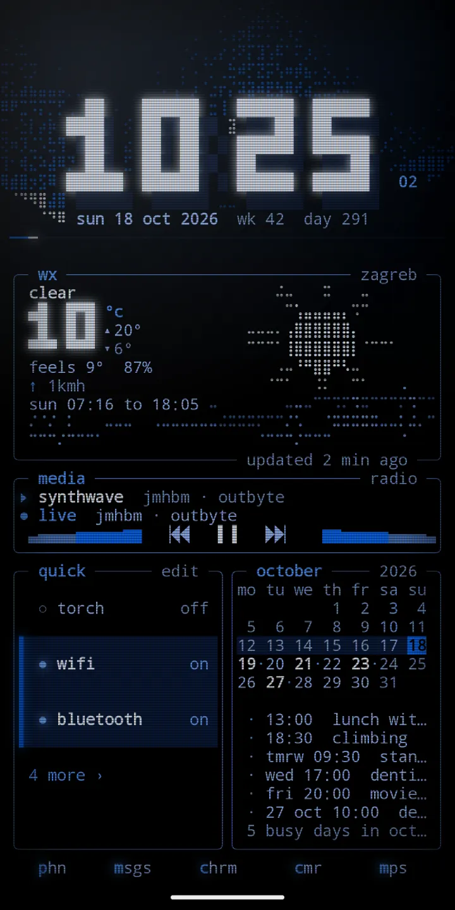

  

<h1 align="center">Phosphor</h1>

Your home screen, as a living terminal. Phosphor draws your whole home screen in text, like an old monitor: a big block clock, a sky that follows the real weather, live gauges, your notifications, small tools, cliamp radio and your apps, all on one glowing grid.

  <a href="https://play.google.com/store/apps/details?id=com.zanoshky.phosphor"><b>Google Play</b></a> ·
  <a href="https://phosphor.zanoski.com"><b>phosphor.zanoski.com</b></a> ·
  <a href="https://zanoshky.github.io/phosphor-launcher/"><b>User guide</b></a> ·
  <a href="https://github.com/Zanoshky/phosphor-launcher/issues/new/choose"><b>Report a bug</b></a>

  

This repo is the public home for Phosphor users: the user guide, bug reports and feature requests. The app itself is a paid Android launcher and its source is not here.

## Quick start

1. Install Phosphor from Google Play. It runs on Android 7 or newer.
2. Open it. The setup guide walks you through six steps: home screen, lock screen, notifications, system lock cards, weather and calendar, and battery.
3. Take the tour. It shows each gesture on your own home and you try it.
4. Swipe sideways for pages, swipe up for apps and search, swipe down for notifications.
5. Hold empty space for edit mode. From there you add panels, manage pages, change the look and open settings.
6. Pick a theme under look, and your home is ready.

## The guide

| Page | What is in it |
| --- | --- |
| [Guide](https://zanoshky.github.io/phosphor-launcher/guide.html) | Everything from A to Z, in order |
| [Use cases](https://zanoshky.github.io/phosphor-launcher/use-cases.html) | Ways to set it up |
| [Cookbook](https://zanoshky.github.io/phosphor-launcher/cookbook.html) | Short recipes, a few taps each |
| [FAQ](https://zanoshky.github.io/phosphor-launcher/faq.html) | Answers and fixes for common problems |
| [Report a bug](https://zanoshky.github.io/phosphor-launcher/report.html) | What to include in a good report |

The guide source is plain HTML in [docs](docs).

## Report a bug or ask for a feature

1. Search the [open issues](https://github.com/Zanoshky/phosphor-launcher/issues) first. If yours is there, add a thumbs up or a comment.
2. Otherwise open a [bug report](https://github.com/Zanoshky/phosphor-launcher/issues/new?template=bug_report.yml) or a [feature request](https://github.com/Zanoshky/phosphor-launcher/issues/new?template=feature_request.yml).
3. Add your app version, phone model and Android version, and a screenshot if you can. Crop out anything private first: issues are public.

## License

The guide text and images in this repo are shared under [CC BY 4.0](LICENSE). The Phosphor app itself is proprietary and is not covered by this license.
